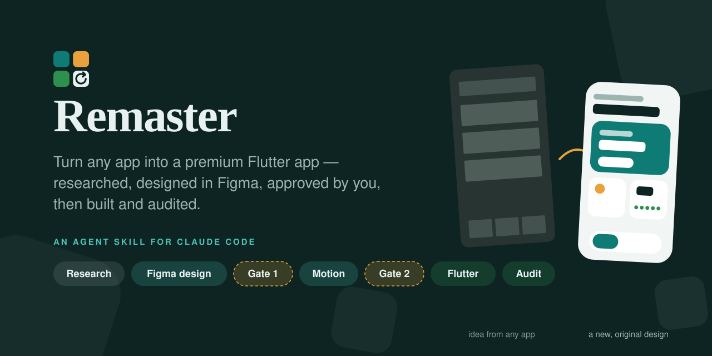
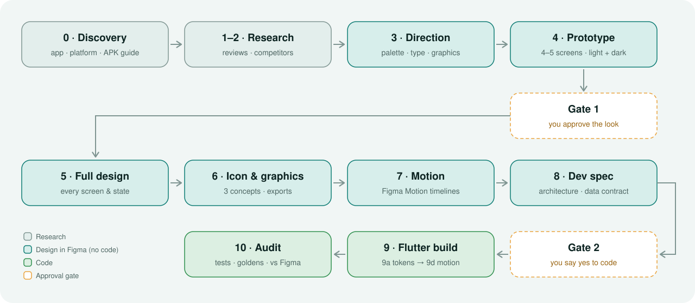

<div align="center">

<picture>
  <source media="(prefers-color-scheme: dark)" srcset="assets/logo-dark.svg">
  
</picture>

### Turn any app into a premium Flutter app.

*Researched. Designed in Figma. Approved by you. Then built and audited.*

[](LICENSE)
[](CHANGELOG.md)
[](#install)
[](AGENTS.md)
[](https://flutter.dev)
[](#works-best-with)
[](https://github.com/afaqxdev/remaster/stargazers)



</div>

---

**Remaster** is an agent skill for Claude Code. Name any app on Google Play or the App Store and it works like a **product designer first and a Flutter developer second**:

- **Researches** the app, its reviews and its competitors.
- **Designs** a modern, original redesign in **Figma**: light and dark, every screen and state, app icon, and animated key moments.
- **Stops for your approval** at two gates.
- **Builds** the approved design in **Flutter** and audits it against Figma.

It takes the *idea* from the original app, never its design.

## Why Remaster

| Without Remaster | With Remaster |
|---|---|
| "Make an app like X" → a generic template or a near-copy | Research → a written list of needs → an **original** design on a blank canvas |
| Screens invented from screenshots | Feature list from store data, reviews, competitors and (optionally) your APK — every claim labeled *verified / inferred / assumption* |
| Code starts before anyone agreed on the look | **Gate 1**: you approve a light + dark Figma prototype. **Gate 2**: you say yes before any code. |
| One template look for every app | An **app-aware** design system derived from each product's purpose, audience and brand — plus a colour-composition check and a design review on every screen |
| "Add some animation" | Key moments built as **Figma Motion timelines** whose springs map 1:1 to Flutter |
| "Looks done" | Scripted audit: analysis, golden tests, emulator screenshots compared with Figma |

## How it works



| Phase | What happens | You get |
|---|---|---|
| **0 · Discovery** | App, platform, optional APK/IPA (with a safe "supply it yourself" guide), project, assets | `status.md` |
| **1–2 · Research** | Store listing, review themes, 2–4 competitors, missing features | `app-dossier.md` + do-not-copy list |
| **3 · Direction** | Brand colour, palette check, type, shapes, icon & illustration style | `design-direction.md` |
| **4 · Prototype** | 4–5 screens in Figma, light **and** dark, self-reviewed | Figma file |
| **⛔ Gate 1** | You approve style, colours, type, layout, navigation, motion | — |
| **5 · Full design** | Every screen and state (loading, empty, error, offline…), responsive, accessible | `design-system.md`, `screen-specifications.md`, `ux-flows.md`, `design-tokens.json` |
| **6 · Icon & graphics** | 3 app-icon concepts → final + Android/iOS exports, custom icons, illustrations | Figma *App icon* & *Graphics* pages |
| **7 · Motion** | Success, level-complete, errors, splash, onboarding as Figma Motion timelines | `motion-system.md` |
| **8 · Dev spec** | Architecture, DI, routes, data contract, mock data, acceptance criteria | `build-prompt.md`, completeness checklist |
| **⛔ Gate 2** | "The Figma design is complete and audited. Shall I convert it into Flutter code?" | — |
| **9 · Flutter** | 9a tokens & widgets → 9b screens & routes → 9c states with injected mocks → 9d graphics, motion, real data | Flutter code |
| **10 · Audit** | `flutter analyze`, unit/widget/golden/integration tests, emulator vs Figma diff, perf, a11y | Pass/fix report |

## Commands

| Command | What it does |
|---|---|
| `/remaster` | The whole workflow, with both approval gates |
| `/remaster-research` | Discovery + research → `app-dossier.md` |
| `/remaster-sample` | Direction + 4–5 screen Figma prototype (light & dark) → Gate 1 |
| `/remaster-motion` | Key moments as Figma Motion timelines → `motion-system.md` |
| `/remaster-build` | Flutter build 9a → 9d (only after Gate 2) |
| `/remaster-audit` | Scripted visual + technical audit |
| `/remaster-store-assets` | Google Play & App Store screenshots + feature graphic: Device-Hero, Lifestyle or Feature-Grid style, a 6-frame story, exact sizes |
| `/remaster-status` | Where your project stands and the next command |
| `/remaster-help` | Quick reference |

Or just ask: *"Remaster the app at https://play.google.com/store/apps/details?id=… for Android."*

## Install

**Claude Code (plugin marketplace)**

```
/plugin marketplace add afaqxdev/remaster
```

```
/plugin install remaster@remaster
```

**Claude Code (manual)**

```bash
git clone https://github.com/afaqxdev/remaster.git
```

```bash
cp -R remaster/skills/* ~/.claude/skills/
```

**Other agents** (Codex, Cursor, Gemini CLI, …): see [AGENTS.md](AGENTS.md). Skills follow the open Agent Skills `SKILL.md` format.

## Works best with

Remaster routes to existing specialist skills instead of re-implementing them, and loads each one **only in its phase**. Anything missing falls back gracefully — it never pretends a skill ran.

| Skill / tool | Used in | Needed? |
|---|---|---|
| Figma MCP server (official; Figma Motion for timelines) | 3–7, 9d, 10 | **Required for Figma output** — otherwise a labeled Figma-ready spec + tokens + SVG wireframes |
| [Flutter SDK](https://flutter.dev) | 9–10 | **Required for code** |
| [ui-ux-pro-max](https://github.com/nextlevelbuilder/ui-ux-pro-max-skill) | 3–5 | Recommended |
| [emil-design-eng](https://github.com/emilkowalski/skills) | 3–7 | Recommended |
| [ponytail](https://github.com/DietrichGebert/ponytail) | 9–10 | Recommended |
| [claude-skills](https://github.com/alirezarezvani/claude-skills): `competitive-teardown`, `ux-researcher-designer`, `ui-design-system`, `apple-hig-expert`, `code-reviewer` | 1–5, 10 | Optional |
| Anthropic `design` plugin: `design-critique`, `accessibility-review` | 5 | Optional |
| A binary-analysis skill (e.g. `reverse-engineer-anything`) or jadx/apktool | 1–2, only with your APK | Optional |

## Rules it never breaks

1. **Ideas, not copies.** The original app's screens, layouts, wording, colours, fonts, icons and design system are never reused; screenshots are read once for a text inventory and never opened again.
2. **No fake evidence, no fake completion.** Nothing is claimed that wasn't accessed, created or verified.
3. **No design before Gate 1, no code before Gate 2.**
4. **Never downloads apps or bypasses DRM.** You supply your own APK/IPA if you want deeper analysis.
5. **Modern, premium, accessible** — enforced checklists, measured contrast, reduced-motion fallbacks.
6. **Respects your project** — existing architecture, state management and logic are preserved.

## Token-friendly by design

`SKILL.md` holds only the workflow and routing; detailed guides live in `skills/remaster/references/` and load per phase. Progress is kept in a ≤ 20-line `status.md`, so you can `/clear` after each gate and continue with *"Use remaster. Read `redesign/<app>/status.md` and continue."*

## FAQ

**Will it clone the app I name?** No. It extracts *what the app does* and *what users want*, then designs something new. Choices that match the original get changed.

**Does it download the APK from the store?** No. Store APK mirrors are unsafe and App Store IPAs are encrypted. It shows you how to pull an APK from your own phone with `adb`, or works from public store data.

**Do I need a paid Figma plan?** The Figma MCP server must be connected. Figma Motion timelines depend on your plan's access to Motion; without it Remaster falls back to Smart Animate prototypes.

**Can I stop after the design?** Yes. Gate 2 is a real question; answering "no" ends with a complete design handoff.

**iOS?** Yes — Android, iOS or both. Apple HIG checks load only when iOS is a target.

**Existing Flutter project?** Remaster audits it first and keeps its architecture, state management and business logic.

## Repository layout

```
.claude-plugin/        plugin + marketplace manifests
skills/remaster/       the orchestrator skill + references/ (phase guides)
skills/remaster-*/     command skills (research, sample, motion, store-assets, build, audit, status, help)
assets/                logo, hero and workflow artwork
evals/                 test prompts with expected behaviour
scripts/validate.py    structure + frontmatter + link checks (run in CI)
```

## Contributing

Ideas, bug reports and new reference guides are welcome — see [CONTRIBUTING.md](.github/CONTRIBUTING.md). Run `python3 scripts/validate.py` before opening a PR.

## License

[MIT](LICENSE) © afaqxdev

<div align="center"><sub>Remaster takes the idea, never the design.</sub></div>
